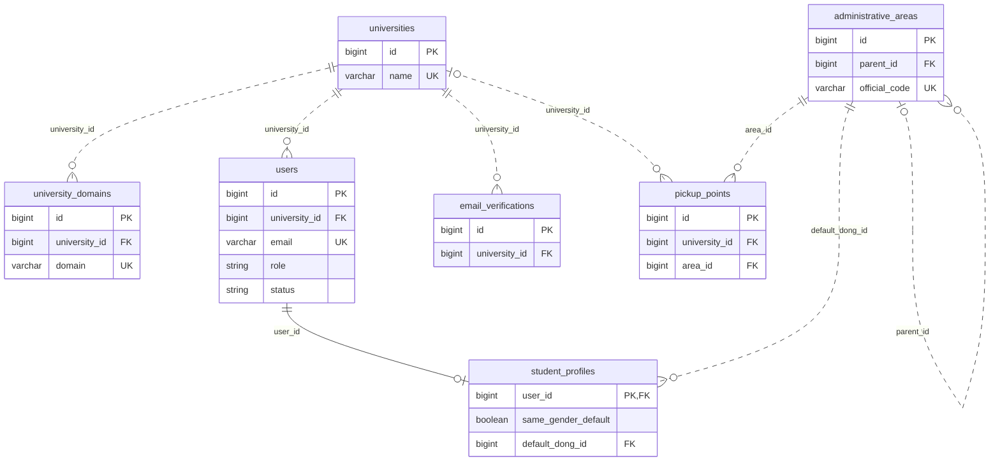
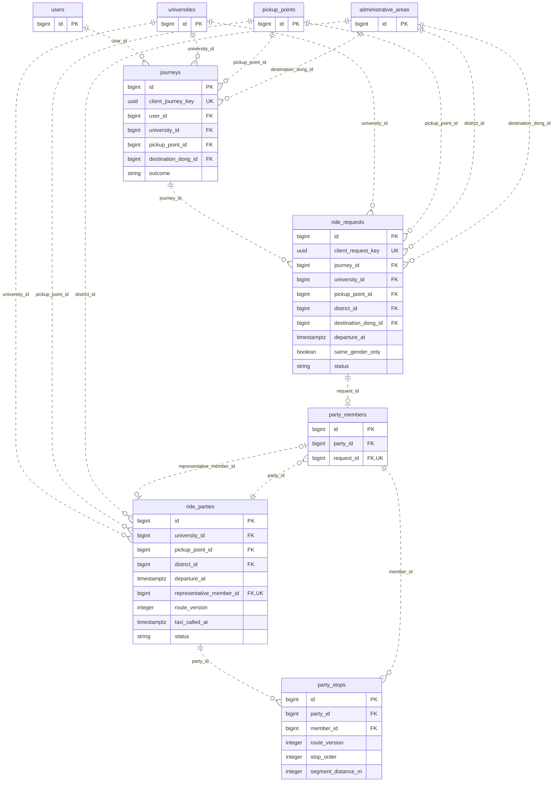
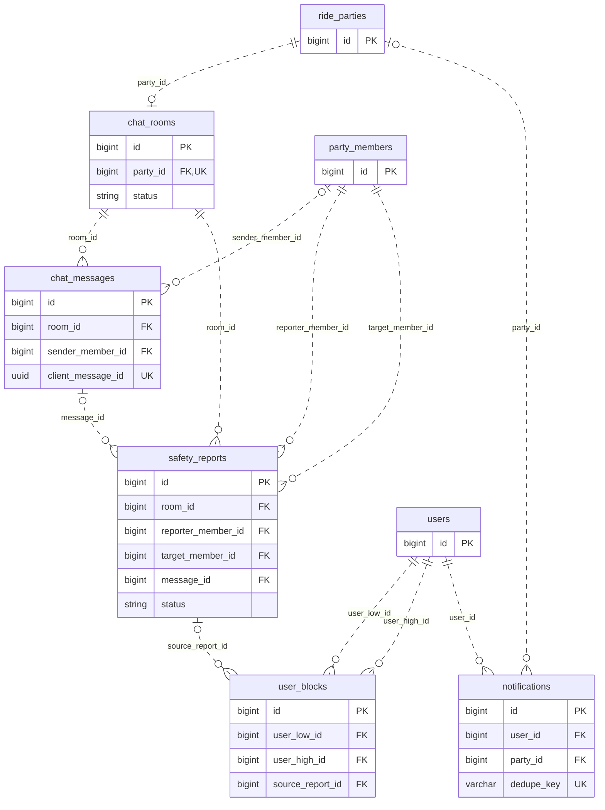
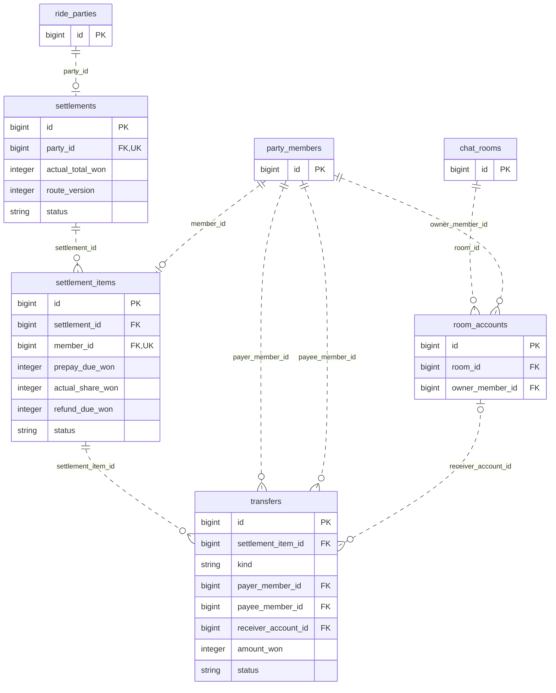
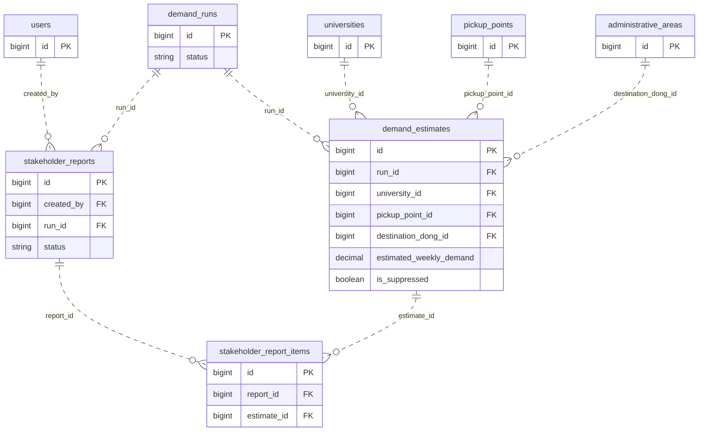

<aside>
📐

원본 「화면 정의서」를 기준으로 만든 아울리 MVP의 관계형 데이터 설계 초안입니다.

25개 테이블을 5개 영역으로 나누고, 각 영역 아래에 필드 정의를 접어 두었습니다. 테이블명·키·상태값·암호화 방식은 개발을 위한 설계 제안이며, 기획에서 확정되지 않은 정책은 마지막 표에 모았습니다.

</aside>

작성일: 2026년 11월 4일 · 재검토: 2026년 11월 5일 · 기준 시간대: Asia/Seoul · 문서 상태: 기획·개발 검토 전

## 설계 기준과 출처

- Figma 원본 「화면 정의서」 — 기획 담당이 설명에 사용한 기준. 화면 하단에는 v1.0 · 2026.11.03으로 표기되어 있습니다.
- 솔루션 핵심 기능, 범위 도출 — 매칭 조건, 거리비례 분담, 학생·관계자 기능.
- 공공데이터 활용 전략 — 수요 집계 차원, 외부 데이터와 추정 근거.
- 페르소나, 유저 저니맵 · 페인포인트, 니즈 도출 · 핵심 가치 도출 — 학생 귀가와 학교·시의 노선 제안 목적.
- Figma 「화면 정의서 v0.2」 — 비교 참고 자료. 원본에 없는 정책은 아래 확인 항목으로 분리.

**정산은 원본 Figma의 ‘선송금 → 대표 실제 요금 입력 → 차액 환급’ 흐름을 채택했습니다.** Notion 기능 문서의 ‘하차 후 송금’ 설명과 차이가 있으며, 이 선택은 이번 ERD의 기준입니다. 선송금 자체는 v0.2에서 처음 추가된 기능이 아닙니다. 원본 선송금 화면 · 원본 정산 입력

## 먼저 보는 핵심 관계

| 영역 | 데이터가 이어지는 방식 | 분리한 이유 |
| --- | --- | --- |
| 가입 | 대학 → 계정 → 학생 프로필 | 학생·관계자 권한과 학교 인증 구분 |
| 매칭 | 귀가 1건 → 매칭 신청 여러 번 → 팟 참여 | 실패 후 재등록 이력을 보존하면서 수요 중복 방지 |
| 동승 | 팟 → 참여자 → 버전별 하차 순서 | 마지막 하차 대표 선정과 순서 변경에 따른 거리 재계산 |
| 소통 | 팟 → 채팅방 → 메시지·신고 | 대화 삭제와 신고 증거 보존을 각각 관리 |
| 정산 | 팟 → 정산 → 개인별 부담액 → 선송금·환급 | ‘보냈어요’와 ‘받았어요’를 각각 기록 |
| 수요 | 귀가 기록 집계 → 산출 버전 → 구간별 추정 | 관측 건수와 AI 추정치를 구분 |
| 관계자 | 후보 선택 → 조치 선택 → 리포트 스냅샷 | 제출 당시 근거와 출력 파일 보존 |

### 표기와 공통 필드

- **PK**: 기본키, **FK**: 외래키, **UK**: 단일 필드 고유키. 복합 고유키는 각 테이블의 제약 설명에 표시합니다.
- 관계도의 원(o)은 0개 허용, 막대는 1개, 갈래는 여러 개를 뜻합니다. 관계는 FK 관점이며 ‘팟의 활성 멤버 2~4명’ 같은 업무 규칙은 별도 검증합니다.
- 이 페이지의 영역별 관계도에는 주요 필드와 연결 대상만 표시합니다. 다른 영역에서 다시 등장한 테이블은 연결을 이해하기 위한 참조입니다. 아울리 ERD 코드 모음 · Mermaid에는 상세 필드 203개와 공통 시각 필드 50개를 포함한 통합 코드가 있습니다. 코드의 NULL·복합 제약 주석은 실제 DB 제약으로 별도 구현해야 합니다.
- 모든 테이블에 `created_at timestamptz NOT NULL`, `updated_at timestamptz NOT NULL`을 공통 적용하는 안입니다. 아래에서는 반복을 생략했습니다.
- ID는 `bigint` 기준 제안입니다. `enum`은 허용 상태를 나타내며 실제 구현은 enum 또는 CHECK 제약으로 선택합니다.
- 금액은 **원 단위 정수**로 저장합니다. 시각은 날짜가 포함된 UTC 기준 시각으로 저장·비교하고, 화면·요일·슬롯 집계는 Asia/Seoul로 변환합니다. 자정 이후 출발을 전날 출발과 혼동하지 않습니다.
- ‘NULL 허용’이 ‘아니오’인 필드는 필수입니다. FK 삭제 규칙·인덱스는 아래 무결성 항목을 함께 적용합니다.

## 1. 계정·학교·기준정보

학교와 계정, 이메일 인증, 학생 프로필을 분리합니다. 행정구역과 출발 거점은 매칭·수요 분석이 함께 참조하는 기준정보입니다.

근거: 학교 이메일 인증 · 프로필 설정 · 관계자 로그인.



### universities — 참여 대학 기준정보

| 필드 | 타입 | 키 | NULL 허용 | 의미 |
| --- | --- | --- | --- | --- |
| `id` | bigint | PK | 아니오 | 내부 식별자 |
| `name` | varchar | UK | 아니오 | 대학명 |
| `is_active` | boolean | — | 아니오 | 서비스 운영 여부 |

**제약·처리:** 초기 대상은 강남대·경희대·단국대·명지대·한국외대. 실제 운영 승인 대학만 활성화.

### university_domains — 대학 이메일 허용 도메인

| 필드 | 타입 | 키 | NULL 허용 | 의미 |
| --- | --- | --- | --- | --- |
| `id` | bigint | PK | 아니오 | 내부 식별자 |
| `university_id` | bigint | FK | 아니오 | 대학 → `universities` |
| `domain` | varchar | UK | 아니오 | 소문자 정규화 도메인 |
| `is_active` | boolean | — | 아니오 | 인증 허용 여부 |

**제약·처리:** 학교별 여러 도메인 허용. 실제 도메인 목록은 확인 후 등록.

### users — 학생·학교 관계자 계정

| 필드 | 타입 | 키 | NULL 허용 | 의미 |
| --- | --- | --- | --- | --- |
| `id` | bigint | PK | 아니오 | 내부 식별자 |
| `university_id` | bigint | FK | 아니오 | 소속 대학 → `universities` |
| `email` | varchar | UK | 아니오 | 정규화한 학교/관계자 이메일 |
| `role` | enum | — | 아니오 | STUDENT / STAFF |
| `password_hash` | varchar | — | 예 | 관계자 비밀번호 해시; 학생 재로그인 방식 미확정 |
| `email_verified_at` | timestamptz | — | 예 | 이메일 인증 완료 시각 |
| `status` | enum | — | 아니오 | ACTIVE / SUSPENDED / WITHDRAWN |
| `suspended_until` | timestamptz | — | 예 | 제한 종료 시각; 무기한 여부는 정책으로 판단 |
| `restriction_reason` | varchar | — | 예 | 접근 제한 사유 코드 |

**제약·처리:** 학생은 인증된 허용 도메인과 소속 대학이 일치해야 한다. 관계자는 발급 계정이며 학생 인증 경로로 STAFF 권한을 얻을 수 없다.

### student_profiles — 학생 개인정보와 기본 귀가 설정

| 필드 | 타입 | 키 | NULL 허용 | 의미 |
| --- | --- | --- | --- | --- |
| `user_id` | bigint | PK, FK | 아니오 | 학생 계정 → `users` |
| `real_name_encrypted` | text | — | 아니오 | 실명 암호화; 대외 표시는 서버에서 부분 마스킹 |
| `gender` | enum | — | 아니오 | 동성 매칭에 사용할 성별; 허용 값은 기획 확정 필요 |
| `same_gender_default` | boolean | — | 아니오 | 동성만 매칭 기본값 true |
| `default_dong_id` | bigint | FK | 아니오 | 기본 하차 행정동 → `administrative_areas` |
| `dropoff_lat_encrypted` | text | — | 아니오 | 기본 하차 핀 위도 암호화 |
| `dropoff_lng_encrypted` | text | — | 아니오 | 기본 하차 핀 경도 암호화 |

**제약·처리:** STUDENT에만 생성. 실시간 현재 위치는 저장하지 않는다. 기본 핀 변경은 이미 등록된 신청의 스냅샷을 변경하지 않는다.

### email_verifications — 가입 전 인증번호 발급·소비 이력

| 필드 | 타입 | 키 | NULL 허용 | 의미 |
| --- | --- | --- | --- | --- |
| `id` | bigint | PK | 아니오 | 내부 식별자 |
| `university_id` | bigint | FK | 아니오 | 인증 대상 대학 → `universities` |
| `email` | varchar | — | 아니오 | 정규화 이메일 |
| `code_hash` | varchar | — | 아니오 | 6자리 코드의 비밀키 기반 해시; 원문 저장 금지 |
| `sent_at` | timestamptz | — | 아니오 | 발급 시각 |
| `expires_at` | timestamptz | — | 아니오 | 발급 후 10분 |
| `consumed_at` | timestamptz | — | 예 | 인증 성공 시각 |
| `invalidated_at` | timestamptz | — | 예 | 재발급 등으로 폐기한 시각 |
| `failed_attempts` | integer | — | 아니오 | 실패 횟수; 차단 기준은 미확정 |

**제약·처리:** 성공 처리는 한 번만 허용. 재발급 시 이전 미사용 코드를 무효화하는 것은 설계 제안. 속도 제한·일일 횟수는 v0.2 확정 전 고정하지 않는다.

### administrative_areas — 시·구·동 계층 기준정보

| 필드 | 타입 | 키 | NULL 허용 | 의미 |
| --- | --- | --- | --- | --- |
| `id` | bigint | PK | 아니오 | 내부 식별자 |
| `parent_id` | bigint | FK | 예 | 상위 행정구역 → `administrative_areas` |
| `official_code` | varchar | UK | 아니오 | 공식 코드 |
| `name` | varchar | — | 아니오 | 지역명 |
| `level` | enum | — | 아니오 | CITY / DISTRICT / DONG |

**제약·처리:** 매칭 권역은 구, 구가 없는 도시는 시. 요청의 district_id에는 해당 CITY 또는 DISTRICT를 참조한다. 집계 단위는 행정동이며 주소 원문은 집계에 전달하지 않는다.

### pickup_points — 고정 출발·집결 거점

| 필드 | 타입 | 키 | NULL 허용 | 의미 |
| --- | --- | --- | --- | --- |
| `id` | bigint | PK | 아니오 | 내부 식별자 |
| `university_id` | bigint | FK | 예 | 학교 전용 거점일 때 소속 대학 → `universities` |
| `name` | varchar | — | 아니오 | 거점명 |
| `area_id` | bigint | FK | 아니오 | 거점 행정구역 → `administrative_areas` |
| `latitude` | decimal | — | 아니오 | 공개 거점 위도 |
| `longitude` | decimal | — | 아니오 | 공개 거점 경도 |
| `meeting_note` | text | — | 아니오 | 집결 위치 안내 |
| `is_active` | boolean | — | 아니오 | 신규 신청 선택 가능 여부 |

**제약·처리:** 대학 정문·역·강남·사당 등 고정 거점. 공용 거점은 university_id가 NULL. 약 12곳이라는 수는 DB 제약으로 고정하지 않는다.

## 2. 귀가 의도·매칭·하차 순서

귀가 한 건(journey)에 매칭 신청을 여러 번 남길 수 있습니다. 실제 팟 참여와 하차 순서를 분리하여 확정·이탈·재등록 이력을 보존합니다.

근거: 동승 등록 · 출발 시간 선택 · 매칭 결과 · 솔루션 핵심 기능, 범위 도출.



### journeys — 한 번의 귀가 의도와 최종 선택

| 필드 | 타입 | 키 | NULL 허용 | 의미 |
| --- | --- | --- | --- | --- |
| `id` | bigint | PK | 아니오 | 내부 식별자 |
| `client_journey_key` | uuid | UK | 아니오 | 귀가 생성 재시도의 멱등키 |
| `user_id` | bigint | FK | 아니오 | 귀가하는 학생 → `users` |
| `university_id` | bigint | FK | 아니오 | 귀가 생성 시 대학 스냅샷; 학교 변경 후에도 과거 집계 소속 유지 → `universities` |
| `pickup_point_id` | bigint | FK | 아니오 | 집계에 사용할 최종 출발 거점 → `pickup_points` |
| `destination_dong_id` | bigint | FK | 아니오 | 집계에 사용할 최종 하차 동 → `administrative_areas` |
| `intended_departure_at` | timestamptz | — | 아니오 | 날짜를 포함한 귀가 예정 시각 |
| `outcome` | enum | — | 아니오 | UNRESOLVED / POOL_BOARDED / BUS_SELECTED / SOLO_SELECTED / CANCELLED |
| `outcome_at` | timestamptz | — | 예 | 결과 기록 시각 |
| `outcome_source` | enum | — | 예 | USER_CHOICE / BOARDING_CONFIRMATION |

**제약·처리:** 재등록은 같은 journey_id를 재사용. 대중교통·혼자 택시 선택은 이용 의사 기록이며 실제 도착의 증거로 취급하지 않는다. 중복 요청 방지는 API 멱등키와 활성 귀가 검사로 처리. 대학은 생성 시 users.university_id를 복사하고 이 귀가의 모든 신청과 일치시킨다. 버스·혼자 택시 선택도 동일한 대학 스냅샷을 남긴다.

### ride_requests — 각 매칭 시도의 조건 스냅샷

| 필드 | 타입 | 키 | NULL 허용 | 의미 |
| --- | --- | --- | --- | --- |
| `id` | bigint | PK | 아니오 | 내부 식별자 |
| `client_request_key` | uuid | UK | 아니오 | 동승 신청 재시도의 멱등키 |
| `journey_id` | bigint | FK | 아니오 | 귀가 의도 → `journeys` |
| `university_id` | bigint | FK | 아니오 | 등록 시 소속 대학 → `universities` |
| `pickup_point_id` | bigint | FK | 아니오 | 출발 거점 → `pickup_points` |
| `district_id` | bigint | FK | 아니오 | 동일 방향 매칭 권역 → `administrative_areas` |
| `destination_dong_id` | bigint | FK | 아니오 | 하차 행정동 → `administrative_areas` |
| `dropoff_lat_encrypted` | text | — | 아니오 | 이번 신청의 하차 위도 |
| `dropoff_lng_encrypted` | text | — | 아니오 | 이번 신청의 하차 경도 |
| `departure_at` | timestamptz | — | 아니오 | 날짜 포함 30분 출발 슬롯 |
| `same_gender_only` | boolean | — | 아니오 | 이번 신청의 동성 제한 |
| `gender_snapshot` | enum | — | 아니오 | 매칭 당시 성별 |
| `status` | enum | — | 아니오 | WAITING / MATCHED / FAILED / CANCELLED / EXPIRED |
| `result_due_at` | timestamptz | — | 예 | 결과 안내 마감; 산정식 미확정 |

**제약·처리:** 동일 귀가에서 활성 신청은 최대 1개. 등록 순서는 created_at, id로 결정. 실패·취소 후 재등록은 새 행으로 남겨 시도와 수요를 분리.

### ride_parties — 형성된 2~4인 동승 팟

| 필드 | 타입 | 키 | NULL 허용 | 의미 |
| --- | --- | --- | --- | --- |
| `id` | bigint | PK | 아니오 | 내부 식별자 |
| `university_id` | bigint | FK | 아니오 | 팟의 대학 → `universities` |
| `pickup_point_id` | bigint | FK | 아니오 | 집결 거점 → `pickup_points` |
| `district_id` | bigint | FK | 아니오 | 매칭 권역 → `administrative_areas` |
| `departure_at` | timestamptz | — | 아니오 | 출발 슬롯 |
| `representative_member_id` | bigint | FK, UK | 예 | 마지막 하차자; 구성 확정 전 NULL → `party_members` |
| `verification_code_encrypted` | text | — | 아니오 | 같은 팟 확인용 4자리 코드 |
| `route_version` | integer | — | 아니오 | 현재 하차 순서·예상 경로 버전 |
| `confirm_deadline_at` | timestamptz | — | 예 | 동승 확정 마감 |
| `taxi_called_at` | timestamptz | — | 예 | 대표가 ‘택시를 불렀어요’를 누른 시각; 실제 호출 API 연동 아님 |
| `status` | enum | — | 아니오 | FORMING / CONFIRMING / PREPAYING / READY / RIDING / SETTLING / COMPLETED / CANCELLED |

**제약·처리:** 매칭 성립·확정 단계에서 유효 멤버 2~4명을 트랜잭션으로 보장. FORMING·CANCELLED는 생성·정리 중 0~1명을 허용한다. 대표는 UNIQUE(representative_member_id)로 중복 사용을 막고 반드시 해당 팟 멤버여야 한다. 모든 신청의 대학·거점·권역·출발 시각이 일치하고 동성 조건을 상호 만족해야 한다. 택시 호출 확인은 선송금 수령 확인이 모두 끝난 뒤 대표만 기록한다.

### party_members — 팟 참여·확정·탑승 상태

| 필드 | 타입 | 키 | NULL 허용 | 의미 |
| --- | --- | --- | --- | --- |
| `id` | bigint | PK | 아니오 | 내부 식별자 |
| `party_id` | bigint | FK | 아니오 | 소속 팟 → `ride_parties` |
| `request_id` | bigint | FK, UK | 아니오 | 배정된 매칭 신청 → `ride_requests` |
| `decision` | enum | — | 아니오 | PENDING / ACCEPTED / DECLINED / LEFT / REMOVED_UNPAID |
| `boarding_status` | enum | — | 아니오 | UNKNOWN / BOARDED / MISSED |
| `confirmed_at` | timestamptz | — | 예 | 동승 확정 시각 |
| `left_at` | timestamptz | — | 예 | 이탈·제외 시각 |
| `boarded_at` | timestamptz | — | 예 | 탑승 확인 시각 |

**제약·처리:** 한 신청은 최대 한 팟에 배정. 재매칭은 새 신청. 동일 팟에 같은 학생이 두 번 들어갈 수 없으며 user_id는 request → journey로 구한다.

### party_stops — 버전별 하차 순서·도로 구간거리

| 필드 | 타입 | 키 | NULL 허용 | 의미 |
| --- | --- | --- | --- | --- |
| `id` | bigint | PK | 아니오 | 내부 식별자 |
| `party_id` | bigint | FK | 아니오 | 팟 → `ride_parties` |
| `member_id` | bigint | FK | 아니오 | 하차 멤버 → `party_members` |
| `route_version` | integer | — | 아니오 | 경로 버전 |
| `stop_order` | integer | — | 아니오 | 하차 순서 1부터 |
| `segment_distance_m` | integer | — | 아니오 | 직전 지점부터 이번 하차까지 도로 경로거리 |
| `routing_source` | varchar | — | 아니오 | 경로 제공자·계산 버전 |
| `calculated_at` | timestamptz | — | 아니오 | 거리 계산 시각 |

**제약·처리:** UNIQUE(party_id, route_version, stop_order), UNIQUE(party_id, route_version, member_id). 출발점은 거점, 하차 좌표는 신청 스냅샷 사용. 정렬/인원 변경 시 새 버전 생성. 실시간 이동 궤적이 아니다.

## 3. 채팅·신고·알림

신고 증거와 재매칭 차단 관계를 분리합니다. 일반 채팅이 종료되어도 필요한 신고 처리와 송금 알림을 별도로 관리할 수 있습니다.

근거: 집결 전 채팅 · 신고하기 · 매칭 알림.



### chat_rooms — 팟 전용 채팅의 생명주기

| 필드 | 타입 | 키 | NULL 허용 | 의미 |
| --- | --- | --- | --- | --- |
| `id` | bigint | PK | 아니오 | 내부 식별자 |
| `party_id` | bigint | FK, UK | 아니오 | 팟당 최대 1개 → `ride_parties` |
| `opened_at` | timestamptz | — | 아니오 | 채팅 오픈 시각 |
| `closed_at` | timestamptz | — | 예 | 닫힘 시각 |
| `delete_after` | timestamptz | — | 예 | 일반 채팅 삭제 예정; 정책 확정 후 계산 |
| `status` | enum | — | 아니오 | OPEN / CLOSED |

**제약·처리:** 일반 채팅 종료·삭제 기산점은 문서 간 차이로 미확정. 계좌 정보는 일반 메시지에 저장하지 않는다. 기획에서 확인된 규칙은 ‘신고된 채팅방 기록 7일 보관 후 삭제’이다. 신고 시점의 보존 범위와 여러 신고의 만료 처리 방식은 기획 확정이 필요하다. safety_reports.evidence_encrypted의 사본도 동일한 확정 보존 정책을 적용하고 일반 삭제 작업이 보존 중인 기록을 먼저 지우지 않도록 한다.

### chat_messages — 마스킹된 대화와 시스템 안내

| 필드 | 타입 | 키 | NULL 허용 | 의미 |
| --- | --- | --- | --- | --- |
| `id` | bigint | PK | 아니오 | 내부 식별자 |
| `room_id` | bigint | FK | 아니오 | 채팅방 → `chat_rooms` |
| `sender_member_id` | bigint | FK | 예 | 시스템 메시지는 NULL → `party_members` |
| `message_type` | enum | — | 아니오 | USER / SYSTEM |
| `body` | text | — | 아니오 | 전화번호·링크·계좌 문자열을 마스킹한 저장 본문 |
| `client_message_id` | uuid | UK | 아니오 | 메시지 재전송 중복 방지 |

**제약·처리:** 멤버는 해당 방의 팟 참여자여야 한다. 마스킹 전 원문은 로그·푸시에도 남기지 않는다. 집결/계좌/정산 카드는 관련 테이블을 조회하여 표시.

### safety_reports — 신고 사건과 제한된 증거

| 필드 | 타입 | 키 | NULL 허용 | 의미 |
| --- | --- | --- | --- | --- |
| `id` | bigint | PK | 아니오 | 내부 식별자 |
| `room_id` | bigint | FK | 아니오 | 신고 발생 방 → `chat_rooms` |
| `reporter_member_id` | bigint | FK | 아니오 | 신고자 → `party_members` |
| `target_member_id` | bigint | FK | 아니오 | 신고 대상 → `party_members` |
| `message_id` | bigint | FK | 예 | 특정 메시지 신고 시; 삭제 시 NULL → `chat_messages` |
| `reason_code` | enum | — | 아니오 | ABUSIVE_LANGUAGE / PRIVACY_REQUEST / NO_SHOW / IDENTITY_MISMATCH / OTHER |
| `evidence_encrypted` | text | — | 예 | 필요한 마스킹된 대화 증거의 암호화 스냅샷 |
| `evidence_delete_after` | timestamptz | — | 아니오 | 신고 기록 7일 보존 후 증거 삭제 예정 |
| `status` | enum | — | 아니오 | RECEIVED / REVIEWED / DISMISSED |

**제약·처리:** 동일 팟의 본인 외 다른 멤버만 신고. 7일의 정확한 기산점은 확인 필요. 증거 삭제 후 차단 관계만 최소 보존할지 운영 정책 확정 필요.

### user_blocks — 두 학생 간 재매칭 금지

| 필드 | 타입 | 키 | NULL 허용 | 의미 |
| --- | --- | --- | --- | --- |
| `id` | bigint | PK | 아니오 | 내부 식별자 |
| `user_low_id` | bigint | FK | 아니오 | 작은 사용자 ID → `users` |
| `user_high_id` | bigint | FK | 아니오 | 큰 사용자 ID → `users` |
| `source_report_id` | bigint | FK | 예 | 신고 원인; 신고 삭제 시 NULL → `safety_reports` |

**제약·처리:** CHECK(user_low_id < user_high_id), UNIQUE(user_low_id, user_high_id). 대칭 차단으로 매칭 후보에서 서로 제외. 신고 누적 제재 횟수는 이 테이블에서 정하지 않는다.

### notifications — 매칭·정산 알림 이력과 발송 예약

| 필드 | 타입 | 키 | NULL 허용 | 의미 |
| --- | --- | --- | --- | --- |
| `id` | bigint | PK | 아니오 | 내부 식별자 |
| `user_id` | bigint | FK | 아니오 | 수신 계정 → `users` |
| `party_id` | bigint | FK | 예 | 관련 팟; 일반 알림은 NULL → `ride_parties` |
| `type` | enum | — | 아니오 | MATCH_RESULT / PREPAY / REFUND / SYSTEM |
| `dedupe_key` | varchar | UK | 아니오 | 동일 사건 알림 중복 방지 |
| `payload` | json | — | 아니오 | 이동할 화면과 최소 요약 |
| `scheduled_at` | timestamptz | — | 아니오 | 발송 예정 |
| `sent_at` | timestamptz | — | 예 | 발송 시각 |
| `read_at` | timestamptz | — | 예 | 읽은 시각 |

**제약·처리:** 푸시에는 실명·정확한 하차 핀·계좌를 포함하지 않는다. 환급 다음날/+3일 알림은 확정된 기준 시각으로 예약.

## 4. 선송금·실제 정산·환급

팟 전체 정산, 개인별 부담액, 실제 외부 이체의 양쪽 확인을 구분합니다. 계좌는 방 범위의 임시 정보로 분리하여 삭제 후에도 금액·확인 이력을 유지합니다.

근거: 대표 계좌 등록 · 선송금 입금 확인 · 실제 정산 입력 · 차액 환급.



### settlements — 팟의 예상금액과 실제 정산

| 필드 | 타입 | 키 | NULL 허용 | 의미 |
| --- | --- | --- | --- | --- |
| `id` | bigint | PK | 아니오 | 내부 식별자 |
| `party_id` | bigint | FK, UK | 아니오 | 팟당 정산 1개 → `ride_parties` |
| `estimated_total_won` | integer | — | 아니오 | 전체 예상 택시요금 |
| `actual_total_won` | integer | — | 예 | 대표가 입력한 실제 요금 |
| `route_version` | integer | — | 아니오 | 분담 계산에 사용하는 하차 경로 버전 |
| `receipt_object_key` | varchar | — | 예 | 비공개 영수증 파일 키; 금액만 입력 시 NULL |
| `status` | enum | — | 아니오 | ESTIMATED / PREPAYING / AWAITING_FARE / REFUNDING / COMPLETED / REVIEW_REQUIRED |
| `finalized_at` | timestamptz | — | 예 | 실제 부담액 확정 시각 |
| `refund_due_at` | timestamptz | — | 예 | 환급 기한; 7일의 기산점 확인 필요 |

**제약·처리:** 매칭 후 예상 정산을 생성하여 선송금에 사용. 원본 화면 기준 실제 요금 상한은 예상 전체 요금 ×1.2. 초과 합의 기능은 v0.2 전용으로 보류.

### settlement_items — 개인별 예상·최종 부담과 환급

| 필드 | 타입 | 키 | NULL 허용 | 의미 |
| --- | --- | --- | --- | --- |
| `id` | bigint | PK | 아니오 | 내부 식별자 |
| `settlement_id` | bigint | FK | 아니오 | 정산 → `settlements` |
| `member_id` | bigint | FK, UK | 아니오 | 부담 멤버 → `party_members` |
| `estimated_share_won` | integer | — | 아니오 | 예상 거리비례 부담액 |
| `prepay_due_won` | integer | — | 아니오 | 대표 제외 ceil(예상 부담액 ×1.2 /100)×100 |
| `actual_share_won` | integer | — | 예 | 실제 요금 기준 부담액 |
| `refund_due_won` | integer | — | 예 | 일반 멤버: 수령 확인된 선송금 − 최종 부담액. 대표: 정산 확정 후 0 |
| `status` | enum | — | 아니오 | ESTIMATED / PREPAID / REFUND_PENDING / COMPLETED / REVIEW_REQUIRED |

**제약·처리:** UNIQUE(member_id): 한 팟 참여자는 해당 팟의 한 정산에서만 개인 정산 행을 갖는다. 정산과 멤버가 같은 팟인지 함께 검증한다. 대표도 실제 부담액 행을 갖지만 자기 선송금·자기 환급은 0이고 자기 이체 행을 생성하지 않는다. 실제 분담 합계는 실제 전체 요금과 일치해야 한다. 일반 멤버의 음수 환급은 추가 송금으로 자동 처리하지 않고 REVIEW_REQUIRED로 남긴다.

### room_accounts — 채팅방에서만 노출하는 수취 계좌

| 필드 | 타입 | 키 | NULL 허용 | 의미 |
| --- | --- | --- | --- | --- |
| `id` | bigint | PK | 아니오 | 내부 식별자 |
| `room_id` | bigint | FK | 아니오 | 유효 범위인 채팅방 → `chat_rooms` |
| `owner_member_id` | bigint | FK | 아니오 | 계좌 소유 멤버 → `party_members` |
| `purpose` | enum | — | 아니오 | PREPAY_RECEIVE / REFUND_RECEIVE |
| `bank_code` | varchar | — | 아니오 | 은행 코드 |
| `account_number_encrypted` | text | — | 아니오 | 암호화 계좌번호 |
| `holder_name_encrypted` | text | — | 아니오 | 암호화 예금주 |
| `delete_after` | timestamptz | — | 예 | 방 종료 시 삭제 예정; 닫힘 전 NULL, 종료 시 즉시 삭제 |

**제약·처리:** UNIQUE(room_id, owner_member_id, purpose). 선송금 계좌는 해당 팟 멤버에게, 환급 계좌는 대표에게만 노출. ‘다음에도 사용’의 기기/서버 보관 범위 미확정으로 장기 계좌 테이블은 만들지 않는다.

### transfers — 외부 수동 이체의 양쪽 확인

| 필드 | 타입 | 키 | NULL 허용 | 의미 |
| --- | --- | --- | --- | --- |
| `id` | bigint | PK | 아니오 | 내부 식별자 |
| `settlement_item_id` | bigint | FK | 아니오 | 개인별 정산 → `settlement_items` |
| `kind` | enum | — | 아니오 | PREPAY / REFUND |
| `payer_member_id` | bigint | FK | 아니오 | 송금자 → `party_members` |
| `payee_member_id` | bigint | FK | 아니오 | 수취자 → `party_members` |
| `receiver_account_id` | bigint | FK | 예 | 수취 계좌; 계좌 삭제 시 NULL → `room_accounts` |
| `amount_won` | integer | — | 아니오 | 양의 정수 금액 |
| `status` | enum | — | 아니오 | PENDING / SENT / RECEIVED / CANCELLED |
| `sent_at` | timestamptz | — | 예 | 송금자 ‘보냈어요’ 시각 |
| `received_at` | timestamptz | — | 예 | 수취자 ‘받았어요’ 시각 |

**제약·처리:** UNIQUE(settlement_item_id, kind). 선송금은 멤버→대표, 환급은 대표→멤버. 은행 입금 확인이 아니라 사용자의 수동 확인임을 UI/API에서 유지. 0원 환급은 이체 행 없이 완료하는 설계 제안.

## 5. 수요 지도·노선 후보·관계자 리포트

노선 후보는 출발 거점→목적지 동의 집계 구간입니다. 수요 산출 버전과 리포트 스냅샷을 남겨, 추정치가 갱신되어도 기존 제출 자료의 근거를 재현합니다.

근거: 학생 수요 지도 · 관계자 노선 후보 · 후보 상세 · 리포트.



### demand_runs — 수요 산출 실행과 입력 근거

| 필드 | 타입 | 키 | NULL 허용 | 의미 |
| --- | --- | --- | --- | --- |
| `id` | bigint | PK | 아니오 | 내부 식별자 |
| `period_start` | date | — | 아니오 | 집계 시작일 |
| `period_end` | date | — | 아니오 | 집계 종료일 |
| `model_version` | varchar | — | 아니오 | 추정/집계 방식 버전; 모델 미정 |
| `input_sources` | json | — | 아니오 | 출처·조회시각·단위·공간/시간 해상도·스냅샷 식별자 |
| `status` | enum | — | 아니오 | RUNNING / SUCCEEDED / FAILED |
| `completed_at` | timestamptz | — | 예 | 산출 완료 시각 |

**제약·처리:** 앱 관측과 공공데이터 추정을 구분. 원시 외부자료 적재·수집기는 별도 인프라이며 이 ERD에서는 재현에 필요한 출처·버전 스냅샷을 관리.

### demand_estimates — 노선 구간별 관측·추정 수요

| 필드 | 타입 | 키 | NULL 허용 | 의미 |
| --- | --- | --- | --- | --- |
| `id` | bigint | PK | 아니오 | 내부 식별자 |
| `run_id` | bigint | FK | 아니오 | 산출 실행 → `demand_runs` |
| `university_id` | bigint | FK | 아니오 | 대학 단위 → `universities` |
| `pickup_point_id` | bigint | FK | 아니오 | 출발 거점 → `pickup_points` |
| `destination_dong_id` | bigint | FK | 아니오 | 목적지 동 → `administrative_areas` |
| `weekday` | integer | — | 아니오 | 서비스 현지 요일 0~6 |
| `slot_start` | time | — | 아니오 | 현지 30분 슬롯 시작 |
| `journey_count` | integer | — | 아니오 | 중복 제거한 귀가 건수 |
| `failed_journey_count` | integer | — | 아니오 | 매칭 실패를 경험한 귀가 건수 |
| `pooled_journey_count` | integer | — | 아니오 | 탑승 확인 귀가 건수 |
| `bus_selected_count` | integer | — | 아니오 | 버스 선택 귀가 건수 |
| `solo_selected_count` | integer | — | 아니오 | 혼자 택시 선택 귀가 건수 |
| `estimated_weekly_demand` | decimal | — | 예 | 주간 추정치; 미산출이면 NULL |
| `candidate_threshold` | decimal | — | 예 | 후보가 되기 위한 최소 수요; 산정 정책 미확정 |
| `candidate_rank` | integer | — | 예 | 추정 수요 순 후보 순위; 후보 아니면 NULL |
| `evidence` | json | — | 아니오 | 공급 격차·근거와 출처/관측시각/단위 |
| `is_suppressed` | boolean | — | 아니오 | 최소 표본 미달로 표시 제한 여부 |

**제약·처리:** UNIQUE(run_id, university_id, pickup_point_id, destination_dong_id, weekday, slot_start). 실패 수는 최종 수단 수와 겹칠 수 있으므로 더하여 총수요로 쓰지 않는다. 원본 기준 후보 정렬은 추정 수요 순이며 복합 점수 순위는 보류.

### stakeholder_reports — 학교 관계자의 리포트 생성 이력

| 필드 | 타입 | 키 | NULL 허용 | 의미 |
| --- | --- | --- | --- | --- |
| `id` | bigint | PK | 아니오 | 내부 식별자 |
| `created_by` | bigint | FK | 아니오 | STAFF 계정 → `users` |
| `run_id` | bigint | FK | 아니오 | 사용한 산출 버전 → `demand_runs` |
| `filters_snapshot` | json | — | 아니오 | 기간·학교·요일·시간대 등 선택 조건 |
| `format` | enum | — | 아니오 | PDF / IMAGE |
| `status` | enum | — | 아니오 | DRAFT / GENERATING / READY / FAILED |
| `file_object_key` | varchar | — | 예 | 생성된 비공개 파일 키 |
| `generated_at` | timestamptz | — | 예 | 파일 생성 시각 |

**제약·처리:** 관계자에게 원시 사용자·핀·채팅·계좌를 제공하지 않는다. 공유 파일에도 5건 미만 숨김을 적용. 1페이지 요약은 화면 규격.

### stakeholder_report_items — 리포트에 선택한 후보와 조치

| 필드 | 타입 | 키 | NULL 허용 | 의미 |
| --- | --- | --- | --- | --- |
| `id` | bigint | PK | 아니오 | 내부 식별자 |
| `report_id` | bigint | FK | 아니오 | 리포트 → `stakeholder_reports` |
| `estimate_id` | bigint | FK | 아니오 | 선택한 노선 후보 → `demand_estimates` |
| `action` | enum | — | 아니오 | SHUTTLE_EXTENSION / CITY_PROPOSAL |
| `display_order` | integer | — | 아니오 | 리포트 내 순서 |
| `candidate_snapshot` | json | — | 아니오 | 출력 당시 구간·순위·근거·단위의 비식별 스냅샷 |

**제약·처리:** UNIQUE(report_id, estimate_id). 서로 다른 산출 실행의 후보를 한 리포트에 혼합하지 않는다. 관계자 열람 권한 범위는 정책으로 분리.

## 6. 반드시 지킬 데이터 무결성

### 매칭과 동승

1. **등록 검증:** 학생·학교 인증·이용 제한 여부를 확인합니다. 같은 학생이 동시에 여러 귀가/신청으로 중복 매칭되지 않도록 활성 상태를 트랜잭션 안에서 검사합니다.
2. **매칭 키:** 대학 + 출발 거점 + 날짜 포함 출발 슬롯 + 도착 권역이 일치해야 합니다. 어느 한쪽이라도 동성만을 선택했다면 해당 조합은 동성이어야 합니다. `user_blocks`에 있는 쌍은 제외합니다.
3. **선착순·인원:** `created_at, id` 순서로 잠금/배정하고, 매칭 성립·확정 시 팟의 유효 멤버가 2~4명인지 검증합니다. 생성·취소 처리 중의 FORMING·CANCELLED는 0~1명을 허용합니다. 인원 이탈 이력과 기존 송금 행은 보존하며, 이미 수령한 돈이 있는 팟의 재매칭·해산은 확인된 정책에 따라 처리합니다.
4. **같은 팟 참조:** 대표·하차 순서·메시지 발신자·신고 당사자·정산 대상·계좌 소유자·송금 양측은 모두 같은 팟 소속이어야 합니다. 단일 FK만으로 부족하므로 복합 FK 또는 서비스 트랜잭션 검증을 적용합니다.
5. **대표:** 마지막 하차자를 대표로 지정합니다. 팟과 참여자의 순환 참조는 팟 생성 → 멤버 생성 → 대표 지정 순서로 저장합니다. 송금 후 대표 교체는 금전 처리 정책이 필요하므로 자동 교체하지 않고 확인 대상으로 남깁니다.
6. **스냅샷:** 프로필 수정은 기존 신청에 소급하지 않습니다. 하차 순서/인원이 바뀌면 경로 버전을 올리고, 정산이 확정된 뒤에는 해당 버전과 부담액을 고정합니다.

### 정산과 삭제

- 송금자가 누른 ‘보냈어요’는 `SENT`, 수취자가 누른 ‘받았어요’는 `RECEIVED`입니다. 선송금 완료 판단은 **RECEIVED**를 기준으로 합니다. 동일 버튼 재시도는 중복 송금을 만들지 않습니다.
- 대표의 자기 선송금·환급은 0원이며 자기 이체 행을 생성하지 않습니다. 모든 유효 일반 멤버의 선송금 수령 확인 후 호출 가능 상태가 됩니다. 대표가 ‘택시를 불렀어요’를 누르면 `ride_parties.taxi_called_at`을 기록합니다. 이는 실제 택시 호출 API 확인이 아닙니다. 출발 +5분 미입금 제외는 원본에 있으나, 제외 후 인원 부족·기수령금 처리 방식은 아래 확인 항목입니다.
- 정산 확정은 실제 요금·하차 순서·개인별 부담액·환급액을 하나의 트랜잭션에서 기록합니다. 원 단위 나머지를 배분하여 개인별 부담 합계와 실제 요금을 일치시킵니다.
- 돈과 연결된 팟·참여·정산·송금 행은 단순 CASCADE 삭제하지 않습니다. 계좌 삭제는 `transfers.receiver_account_id`를 **SET NULL**로 남깁니다. 계좌 원문을 송금 이력·알림·리포트에 복제하지 않습니다.
- 메시지 삭제 시 `safety_reports.message_id`, 신고 사건 삭제 시 `user_blocks.source_report_id`는 SET NULL입니다. 신고 보존 중에는 방을 먼저 물리 삭제하지 않습니다. 증거·메시지·첨부 사본의 삭제 작업을 함께 설계합니다.
- 대화·계좌·정확한 하차 핀·영수증 접근 권한을 각각 제한합니다. 학교 관계자 역할은 수요 집계·리포트만 사용하며 신고 증거 열람 권한과 구분합니다. 탈퇴·분쟁 기록·영수증의 보관 기간은 추가 확정 사항입니다.

### 제안 인덱스

| 테이블 | 인덱스 또는 고유 제약 | 용도 |
| --- | --- | --- |
| users | UNIQUE(email) | 계정 중복 방지 |
| email_verifications | (email, sent_at DESC) | 최근 유효 인증 조회 |
| journeys | (user_id, intended_departure_at DESC) | 내 귀가 이력·활성 귀가 확인 |
| ride_requests | (university_id, pickup_point_id, district_id, departure_at, status, created_at, id) | 같은 조건 대기열·선착순 배정 |
| ride_requests | 활성 상태에 한해 UNIQUE(journey_id) | 귀가당 동시 활성 신청 방지 |
| ride_parties | UNIQUE(representative_member_id), NULL 제외 | 한 참여자가 다른 팟의 대표로 재사용되는 것 방지 |
| party_members | UNIQUE(request_id), (party_id, decision) | 중복 배정·현재 멤버 조회 |
| party_stops | UNIQUE(party_id, route_version, stop_order), UNIQUE(party_id, route_version, member_id) | 버전별 순서와 멤버 중복 방지 |
| chat_messages | (room_id, created_at, id) | 채팅 순서 조회 |
| user_blocks | UNIQUE(user_low_id, user_high_id) | 대칭 차단 확인 |
| settlement_items | UNIQUE(member_id) | 한 팟 참여자의 개인 정산 중복 방지 |
| transfers | UNIQUE(settlement_item_id, kind) | 선송금·환급 확인 중복 방지 |
| notifications | UNIQUE(dedupe_key), (sent_at, scheduled_at) | 알림 중복 방지·예약 발송 |
| demand_estimates | UNIQUE(run_id, university_id, pickup_point_id, destination_dong_id, weekday, slot_start) | 집계 셀 중복 방지 |
| stakeholder_report_items | UNIQUE(report_id, estimate_id) | 같은 후보 중복 담기 방지 |

상태 조건이 들어간 고유 제약은 DB별 부분 인덱스 지원에 맞게 구현합니다. 일반 FK 인덱스와 각 테이블에 명시한 다른 고유 제약도 함께 적용합니다.

## 7. 정산 계산 검산

**기획 기준:** 각 구간의 요금을 그 구간에 함께 탄 사람끼리 나눕니다. 전체 요금을 단순히 인원수로 나누지 않습니다. 거리는 저장된 하차 핀과 순서의 예정 도로 경로이며 현재 위치 추적을 사용하지 않습니다. 솔루션 핵심 기능, 범위 도출

```
구간 요금 = 전체 택시요금 × (해당 구간 거리 / 전체 경로 거리)
개인 부담액 = 본인이 타고 있는 각 구간의 [구간 요금 / 해당 구간 탑승 인원] 합
일반 멤버 선송금액 = ceil(예상 개인 부담액 × 1.2 / 100) × 100
일반 멤버 차액 환급액 = 수령 확인된 선송금액 − 실제 개인 부담액
대표 자기 선송금액 = 0, 대표 자기 환급액 = 0
```

예상 요금과 실제 요금이 모두 30,000원이고, A → B → C 순서로 하차하며 누적 거리가 8km → 12km → 16km인 경우:

| 구간 | 구간 거리 | 함께 타는 인원 | 구간 요금 | 해당 구간 1인 부담 |
| --- | --- | --- | --- | --- |
| 출발 → A | 8km | A·B·C 3명 | 15,000원 | 5,000원 |
| A → B | 4km | B·C 2명 | 7,500원 | 3,750원 |
| B → C | 4km | C 1명 | 7,500원 | 7,500원 |

| 사람 | 최종 부담 | 선송금 | 환급 |
| --- | --- | --- | --- |
| A | 5,000원 | 6,000원 | 1,000원 |
| B | 8,750원 | 10,500원 | 1,750원 |
| C · 대표 | 16,250원 | 0원 | 자기 환급 없음 |

검산: **5,000 + 8,750 + 16,250 = 30,000원**. 대표는 전체 택시요금을 결제하고, 다른 멤버의 선송금과 환급을 반영한 순부담이 16,250원이 됩니다.

**구현 제안:** 계산 중에는 정밀 소수로 유지하고 최종 개인별 원 단위 금액에서 최대 나머지 방식으로 잔여 원을 배분합니다. 동률은 고정된 member_id 순으로 처리합니다. 환급 0원 항목은 이체 확인 없이 완료합니다. 이 두 세부 규칙은 기획 문구가 아닌 설계 제안입니다.

**예외:** 전체 요금이 예상의 1.2배 이하여도 하차 순서·인원이 달라지면 특정 개인의 최종 부담이 선송금을 넘을 수 있습니다. 음수 환급을 0원으로 덮거나 자동 추가 송금 처리하지 말고 `REVIEW_REQUIRED`로 남겨 정책을 확인합니다.

## 8. 수요 중복 방지와 외부 데이터

### 집계 단위

**귀가 1건을 기본 집계 단위로 삼는 설계 제안**입니다. 매칭 신청 건수와 귀가 건수를 구분합니다.

예: 같은 귀가에서 첫 신청 실패 → 다음 슬롯 재등록 실패 → 막차 선택이면:

| 지표 | 기록할 값 |
| --- | --- |
| 귀가 수요 | 1건 |
| 매칭 시도 | 2건 |
| 매칭 실패를 경험한 귀가 | 1건 |
| 최종 막차 선택 | 1건 |

‘실패 경험 1건’과 ‘막차 선택 1건’을 합쳐 2명의 수요로 표시하지 않습니다. 실패율의 분모는 매칭을 신청한 귀가로, 최종 수단 비율의 분모는 집계 대상 귀가로 구분합니다. 중도 취소 포함 여부·기간 경계·재등록 구간 변경 시 귀속 기준은 지표 정의에서 확정해야 합니다.

5건 미만 구간은 학생 화면·관계자 화면·내보낸 리포트에서 모두 숨깁니다. 원문은 **‘등록 5건’**이므로 중복 제거 귀가 수 또는 고유 학생 수 중 어느 기준을 적용할지 확인이 필요합니다. 이 초안의 임시 제안은 journey_count 기준이며, 승인을 받은 기준으로 `is_suppressed`를 계산합니다. 미달 수치를 리포트 스냅샷에 우회 노출하지 않습니다.

### DB에 직접 저장하지 않는 계산·연동

| 항목 | 처리 위치와 저장 범위 |
| --- | --- |
| 현재 GPS 위치 | 가까운 거점 추천·막차 출발 판단에 일시 사용. 현재 좌표와 이동 궤적을 사용자 DB에 저장하지 않음 |
| 막차 경로·마지막 출발 시각 | GBIS 등 외부 자료를 바탕으로 출발 거점×도착 동×운행일 기준 계산·캐시. 수집시각·유효기간·출처를 캐시에 보존하며 실제 노선/환승 범위는 검증 필요 |
| 같은 조건 대기 인원 | 유효 ride_requests 집계. 팟 테이블의 누적 멤버 수와 구분 |
| 예상 요금·ETA·도로 거리 | 요금/경로 계산 서비스. 정산에 사용한 거리·요금 결과와 버전을 저장. 실제 데이터 연동 완료를 전제하지 않음 |
| 은행 송금·택시 호출 | 외부 앱에서 수행. 본 서비스는 수동 확인 상태를 저장하며 PG·은행 입금 사실을 자동 확인하지 않음 |
| 공공데이터 원본 | 수집·분석 저장소 또는 캐시. demand_runs에 출처·시점·해상도·버전 식별자를, demand_estimates에 해당 결과의 근거를 저장 |
| 개인 ‘내 귀가 반영 횟수’ | 본인 journeys를 집계. 관계자에게 개인별 기록을 전달하지 않음 |

경기도 시간대별 버스 이용객, 수도권 생활이동, 용인앱택시, 기존 심야버스 공급은 해상도가 서로 다릅니다. 구·월 단위 자료를 동·30분 단위 실측치라고 표시하지 않고, 보정·추정 방식과 불확실성을 결과에 함께 기록합니다. 원본 화면의 후보 목록은 **추정 수요 순**으로 정렬합니다.

## 9. 기획 담당과 확인할 정책

아래 항목은 페이지를 읽을 때 확정 요구사항과 혼동하지 않도록 별도 표시했습니다. ERD에는 필요한 상태·시각·스냅샷을 준비하되 미확정 숫자나 제재 기준을 고정 제약으로 넣지 않았습니다.

| 항목 | 문서에서 확인한 차이·빈칸 | 이번 설계 처리 |
| --- | --- | --- |
| 기준 버전 | 기획 설명은 원본 화면 정의서 사용. 별도로 v0.2 존재 | 원본 우선. v0.2 정책 적용 여부는 별도 확정 |
| 송금 순서 | Notion 기능 문서는 하차 후 송금, 원본 Figma는 선송금 후 환급 | 원본 Figma 채택 |
| 채팅 종료·계좌 삭제 | Notion은 정산 완료 +1시간/최대 24시간, v0.2는 출발 +1시간 및 정산 연장 | 종료 시각을 저장하고 정책은 보류. 장기 환급과 계좌 삭제가 충돌하지 않게 확정 필요 |
| 계좌 재사용 | 원본의 ‘다음에도 사용’과 방 종료 시 계좌 삭제가 함께 있음 | 장기 서버 저장 제외. 기기 보관/재입력/동의 범위 확정 필요 |
| 선송금 후 취소·제외 | 원본은 출발 15분 전까지 취소, 출발 +5분 미입금 제외. 수령금 환급·인원 부족 처리는 불명확 | 기존 송금 이력 보존. 재매칭·팟 해산·재분담·대표 교체 규칙 보류 |
| 실제 순서 변경·미탑승 | 정산 전 순서 수정 가능. ‘못 탔어요’ 이후 분담·환급은 미정 | 경로 버전과 탑승 상태 분리. 대표 변경·개인 초과부담을 수동 검토 대상으로 유지 |
| 요금 상한 초과 | 원본은 예상 전체 요금 ×1.2 입력 상한, v0.2는 전원 동의 예외 | 상한 적용. 전원 동의 테이블/기능은 채택하지 않음 |
| 인증·로그인 | 인증 코드는 6자리·10분. 학생 재로그인, 세션·실패 잠금 정책 미정 | 학생 password_hash 선택 필드. v0.2의 재발송·횟수·잠금 수치와 30일 세션 보류 |
| 매칭 시각 | 원본은 막차 출발 전에 결과 안내. v0.2는 등록/출발 시간 범위와 결과 산정식 추가 | 날짜 포함 슬롯·마감 시각 저장. 운영 시간과 정확한 산정식 보류 |
| 미정산 제재 | Notion은 정산 완료 전 새 동승 제한, 원본은 환급 7일 지연 시 대표 정지 | 미정산 조회와 계정 제한 표현 가능. 제한 대상·기산점·해제 조건 확정 필요 |
| v0.2 추가 제재 | 신고 3회, 계좌 미등록 7일, 다수 미탑승 환급 등 추가 정책 | 자동 적용하지 않음 |
| 신고·개인정보 보관 | 원본은 신고된 방 기록 7일 보관. 기산점·여러 신고·탈퇴 후 보관 미정 | 보존 만료 필드와 차단 관계 분리. 정확한 삭제/보관 정책 확정 필요 |
| 수요·후보 기준 | 등록 5건의 단위, 후보 임계치, AI 모델 미정. 공공데이터 전략/v0.2에는 복합 점수도 등장 | 관측·추정 분리, 후보 임계치 필드 준비. 현재 목록은 원본의 추정 수요 순 |
| 관계자 권한 | 학교 관계자 로그인은 있으나 대학별 열람 범위가 불명확 | STAFF 권한으로 개인 원자료 차단. 타 대학 집계 열람 범위는 별도 정책 |
| 초기 기준정보 | 이메일 도메인, 거점 실제 좌표, 행정구역 코드 확정 필요 | 임의 실데이터를 넣지 않고 기준 테이블만 설계 |

## 10. 재검토 결과

검토일: 2026년 11월 5일 · 기준: 원본 화면 정의서와 현재 상세 필드 정의

| 확인한 문제 | 반영한 수정 |
| --- | --- |
| 통합 코드가 상세 필드 201개 중 112개만 담은 요약본이었음 | 상세 필드 전체와 공통 created_at·updated_at을 포함하도록 확장. 추가 보완 후 업무 필드 203개 + 공통 필드 50개 = 총 253개 |
| 대표자 관계가 여러 팟에 연결 가능한 것으로 표시됨 | representative_member_id에 UNIQUE와 같은 팟 검증을 명시하고 관계를 0..1로 수정 |
| 한 팟 참여자의 개인 정산 중복 방지가 불충분했음 | settlement_items.member_id를 UNIQUE로 보강. 정산 대상과 팟 일치 검증 유지 |
| 대표에게 일반 멤버 환급 공식을 적용하면 음수 자기 환급이 발생함 | 대표 자기 선송금·환급은 0원, 자기 이체 행 없음으로 명시 |
| 귀가 당시 대학과 ‘택시를 불렀어요’ 동작의 저장 필드가 빠져 있었음 | journeys.university_id 스냅샷과 ride_parties.taxi_called_at 추가 |
| 팟 생성·취소 중에도 항상 2~4명이라는 설명이 초기 저장 순서와 충돌함 | 인원 제한은 매칭 성립·확정 시 적용. 생성·취소 중 0~1명 허용 |
| 신고 기록의 기산점·여러 신고 처리안을 확정 정책처럼 설명한 부분이 있었음 | 원본의 ‘신고된 방 기록 7일 보관’과 세부 설계 가정을 구분 |

### 검증 결과

- **구조:** 25개 테이블, 54개 FK 관계, 5개 영역별 관계도. 상세 필드와 통합 코드의 이름·타입·키·NULL 허용 여부를 대조했습니다.
- **정산:** 원본 30,000원 예시, 원 단위 나머지가 생기는 금액, 2~4인 구성, 같은 위치 하차를 포함한 6개 계산 사례에서 부담액 합계가 전체 요금과 일치했습니다. 전체 경로 거리 0은 계산 전에 거부하도록 명시했습니다.
- **대표 예외:** 선송금 6,000/10,500/0원, 환급 1,000/1,750/0원으로 검산했습니다. 하차 순서 변경으로 일반 멤버의 부담이 선송금을 초과하는 사례도 별도로 확인했습니다.
- **표기:** Mermaid 공식 ERD 문법의 별칭·관계·복수 키·필드 주석 형식과 대조했습니다. NULL·복합 고유 제약 주석은 설명용이므로 실제 DB 제약으로 구현해야 합니다.
- **검증 범위:** 문서·코드 정합성과 계산 검증을 완료했습니다. 실제 DB 마이그레이션 실행과 Notion 화면의 렌더링 검증은 포함하지 않습니다.

기획 확인이 필요한 항목은 9절에 유지했습니다. 특히 선송금 후 취소·대표 교체·미탑승 환급, 채팅 종료와 계좌 삭제의 시점, ‘등록 5건’의 집계 단위를 확정해야 합니다. 원본에 없는 v0.2 제재·시간 제한은 자동 채택하지 않았습니다.

이 문서는 논리 ERD와 필드 설계이며, 실행 가능한 DB 마이그레이션·운영 데이터 연동·API 명세는 이후 구현 단계의 산출물입니다.